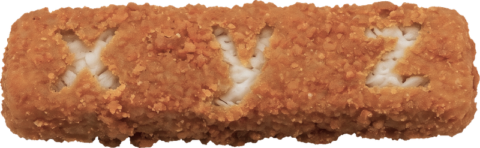

<p align="center">
  
</p>

# Fishstick: Persona Embeddings

[](https://huggingface.co/datasets/EdwardHuy/persona-queries)
[](https://huggingface.co/EdwardHuy/persona-embeddings)

Fishstick is an embedding model made by fine-tuning [Qwen3-Embedding-0.6B](https://huggingface.co/Qwen/Qwen3-Embedding-0.6B) with
LoRA to retrieve a person from a short description of their interests, work or background.
There is one model per language, Dutch and English. The trained models are published as
[EdwardHuy/persona-embeddings](https://huggingface.co/EdwardHuy/persona-embeddings),
together with usage examples and the full evaluation.

Training data is the [persona query dataset](https://huggingface.co/datasets/EdwardHuy/persona-queries),
made with [persona-queries](https://github.com/schwaartz/persona-queries): three short queries
per person in Dutch and English. The full profile each query should retrieve is taken from
the same person in [Nemotron-Personas-Belgium](https://huggingface.co/datasets/nvidia/Nemotron-Personas-Belgium).

## Setup

Requires [uv](https://docs.astral.sh/uv/) and an NVIDIA GPU; training with the default batch
size of 128 persons uses about 10 GB of VRAM. The query dataset is gated: request access on
its Hugging Face page and log in before the first download.

```bash
uv sync
uv run hf auth login
uv run python src/dataset.py    # downloads the queries and the Nemotron profiles to data/
```

## Training and evaluation

```bash
uv run python src/evaluate.py --baselines                               # untuned Qwen and E5-NL
uv run python src/train.py --language nl --epochs 5 --seed 42           # queries of the same person as positives
uv run python src/train.py --language nl --objective mixed --epochs 1   # ... and the full profile as well
uv run python src/evaluate.py                                           # table of all results
```

The published models are the `mixed` runs with one epoch and seed 42, one for each language
(`--language nl` and `--language en`).

Persons are split by a hash of their UUID into 400 test, 200 validation and the
remaining training persons, identically for both languages. Two retrieval tasks are
measured on the test persons:

- **q2q**: a query has to find the other queries of the same person.
- **q2d**: a query has to find the full profile of its person.

Each run writes its LoRA adapter and `result.json` to `output/<run name>/`.

| File | Content |
| --- | --- |
| `src/dataset.py` | download, profiles, train/validation/test split, batches with one pair per person |
| `src/encoder.py` | Qwen3-Embedding and E5 encoders |
| `src/train.py` | LoRA fine-tuning |
| `src/evaluate.py` | retrieval metrics, baselines and the results table |

## License

This project is licensed under the [Creative Commons Attribution 4.0 International License (CC BY 4.0)](https://creativecommons.org/licenses/by/4.0/). See [LICENSE](LICENSE) for the full text.
